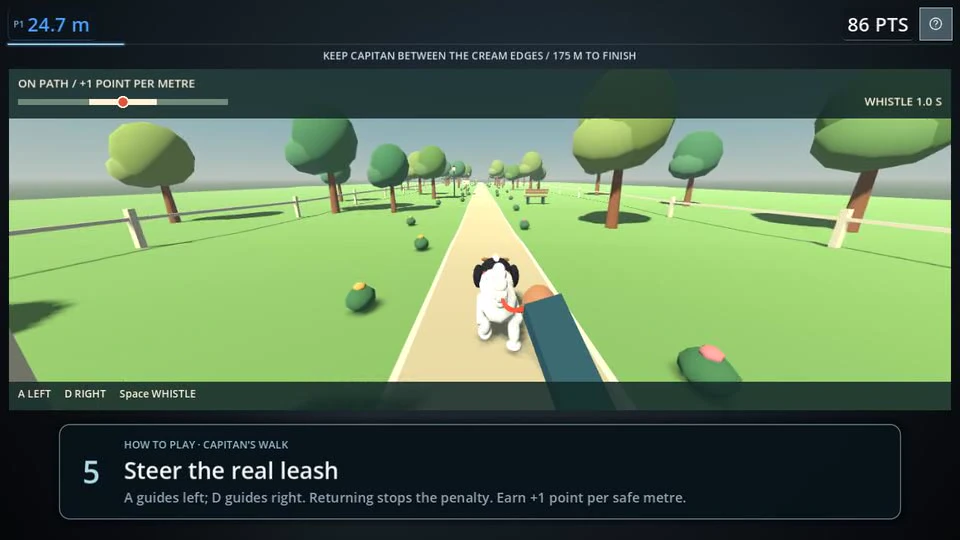

# Capitan's Walk

**A first-person dog-guidance game in an original low-poly 3D Park.** Walking
is automatic: steer the leash and Whistle to keep Capitan between the cream
path edges. Reach the **200 m finish** before your points run out.

Start at **100 points**, earn **one per safe metre**, and lose **ten per
second** after one continuous second off-path. Returning stops the penalty
and resets that grace period. Zero points loses; human falls no longer do.



The current owner-approved rules are in [DESIGN section 0](DESIGN.md).
The older four-key physics model and diagnostic spike remain available;
they are not the main game. This is playable original art, not Capitan's
verified final likeness or a release build. Pickups, other routes, progression,
store and multiplayer remain unimplemented.

## Controls

| Keyboard | Fixed gamepad | Action |
| --- | --- | --- |
| A / D | Left stick or D-pad left / right | Guide the leash left / right |
| Space | A | Recall Capitan after 0.3 s; six-second model-time cooldown |
| R | Y or Back | Restart immediately, including from results |
| Escape | Start | Pause |

Keyboard actions are rebindable in Settings; gamepad controls are fixed.
The left stick preserves analogue strength beyond its release deadzone.
One active controller owns the controls until reset or disconnect.
Start also resumes pause and backs out of nested Settings before resuming.

Touch controls appear on touchscreens or the first screen touch on a hybrid
desktop. Independent left/right steering pads and Whistle, Restart and Pause
buttons offer **Thumbs / Left-handed / Right-handed** layouts.
Whistle shows its model-time cooldown and readiness on the button.
Dragging off releases that finger; another finger on the same pad stays held.
The controls reserve space below the 3D view.
Keyboard, gamepad and touch can coexist without releasing each other's inputs.
Pause, focus loss and restart clear held controls; touch-layout/viewport changes
release contacts without releasing the other sources.

Equal opposing strengths cancel. Releasing recentres the leash hand; forward
walking continues. Whistle returns Capitan physically, never by teleporting.
Release before calling again.

**Walk speed** offers 100%, 85% and 70% model time. **Long warnings** doubles
each warning, including its remaining time when enabled live. Both preserve
the 120 Hz solver; slower pace also slows penalties and cooldowns. The assisted
badge stays set if either assist was used. Reduced motion parks decorative dog
animation; the first-person camera has no bob. Help folds key legends, never
the score, warning captions or active touch pads.

## The first-person walk

Capitan's model centre/collar must stay within the **1.8 m wide path**; touching
an outer cream edge is safe. Points accrue fractionally each fixed tick and the
live whole-number score rounds up until it actually reaches zero. Distance
never decreases, never rewards backtracking and stops at 200 m. Depletion wins
over reaching the finish on the same tick.

Squirrels, pigeons and friendly dogs tempt him toward the grass. Each
distraction names its side and the counter-steering direction one second
before pulling. Watch the dog and red leash; steer against the distraction or
Whistle. The path gauge and OFF PATH caption show the grace countdown or
active deduction even with sound and Help off.

The route uses **seed 0**; Restart repeats it. A friction-limited motor paces
the human along generated slopes and wet patches. The damped hand motor,
dog steering and spring-damper rope exchange real equal/opposite forces.
The renderer only reads that state. Legacy sniffing/happiness drain,
stride combos and human-fall endings are inactive in this mode.

`world\walk_view.gd` owns an isolated perspective viewport using
`gl_compatibility`. Game-owned meshes supply Capitan, his actual leash and
the park's trees, flowers, benches, fences, lamps, signs and finish gate.
The same physical model runs under keyboard, gamepad and touch.
Shared results retain distance, remaining points, safe metres, excursions
and deductions. The 200 m length is a first-pass route, not a human-tuned
progression threshold.

## Legacy diagnostic model

The following describes the retained **side-view model and its regression
fixtures**, not the current first-person game. The direct spike uses Q/W
thighs and O/P calves (LB/LT/RB/RT), Space to recall, R to reset and Left/Right
for development-only sideways tugs. Its default drawing remains diagnostic.

| Icon | Mood | Counter |
| --- | --- | --- |
| ! | Squirrel: sharp forward/sideways lunge | Plant both feet and lean back |
| H | Hydrant: slow sideways drag, then sniff | Stop and let him sniff |
| V | Pigeon: three to five alternating tugs | Stand still; step between beats |
| ~ | Food: sustained forward or backward drag | Lean against the indicated direction |
| Z | Sit-down protest: stationary anchor | Stop for two uninterrupted seconds |

Each warning has its own caption, icon and original synthesized cue. The first
warning remains the squirrel lesson; subsequent choices are seeded and weighted
by Capitan's profile. Later intervals depend on distance and happiness.
There are no recorded dog barks.

Grass rings mark generated, hazard-free sniff spots, starting at **4 m**.
Sustain a settled stance nearby to let Capitan sniff.
Happiness starts at **60/100**: sniffing fills **4/s**; walking without a sniff
drains **1/s after 20 s**. Calling him off a sniff costs **10**, actually pulling
a protest costs **15 once**, and a taut-rope near-fall costs **5 once**.
Lower happiness increases pulling and distraction frequency; zero means
determined, not a failed walk. Treat/event fills belong to later milestones.

An alternating foot plant **0.45-0.9 s** after the previous one, within
**15 degrees** of upright, builds rhythm. Strut/Swagger/Parade/Best in Show
start at **5/12/25/50** good strides and bank **x1.5/x2/x3/x4**.
Each driven plant banks a provisional **10 points** before its combo multiplier;
landing after releasing the key still counts. Knees, repeated feet, mistimed
plants or a lean beyond 30 degrees break the combo, never the bank.
Combos of five or more also add one happiness per good stride.

Distance remains the headline. Final points apply the ending happiness
multiplier **x1.0-x2.0 once**; results show both, the real cause and Capitan's
one-to-five-wag verdict. Stats retain foot plants/falls and add rhythm, model
time, happiness, sniffs and leash measurements. An assist badge stays set if
any assist was used, even when switched off before ending. The best-walks table
and its assisted presentation are not built yet.

The rope starts with 0.3 m of slack, goes taut at 1.8 m horizontal separation,
and clamps force at 260 N. Both endpoints receive equal/opposite X/Z force;
the existing hand/shoulder spring carries the load into the torso.
The development spike also accepts Left/Right arrow **sideways tugs** to compare
bracing and striding. Those tugs are not controls in the main game.

### Legacy seeded Park fixtures

The retained Park generator also supports the original endless model fixtures.
The first 20 m stays flat for the original leash lesson. After that,
sixteen authored 20 m templates supply three provisional difficulty
tiers, wet patches, rises, dips, rest areas and moving encounters. The 50/150 m tier bands
follow the design, not tuned unlock distances.

Each cell has its own seed. Streaming retains only a window around both actors;
previewing, backtracking and eviction cannot consume dog RNG or change the route.
Seams are continuous and duplicate vertices are removed before contact solving.
Sniff rings remain at most 40 m apart and at least 6 m clear of the **whole
hazard interval**, including neighbouring chunks. Fixed event/boss positions
reserve quiet space and shift rings safely, even at adjacent reservations.
Those are data only: there are no playable events or bosses yet.

**~ PUDDLE** patches lower actual contact friction from 0.90 to **0.30** for
their width. Shoe-contact edges produce an original splash tone and caption,
not repeated splashes while standing. **^ SLOPE** profiles are the actual
contact geometry; gravity acts on the walker and the dog, outside the dog's
happiness-scaled drive. The HUD gives readable surface feedback without
displacing dog warnings or recall. The view never advances the model.

| Park cue | Physical effect and counter |
| --- | --- |
| * Sprinkler | Ticks for 0.8 s before each sideways water sweep. Plant both feet; stopping nearby can let Capitan play/sniff. Whistle cancels his interest, **not the water**. |
| J Jogger | Approaches from the front, passes and draws Capitan backward through the actual rope. Brace or Whistle. |
| VV Pigeon flock | Three alternating sideways tug beats. Plant; step between beats or Whistle. This is separate from the seeded pigeon **mood**. |
| D Friendly dog | Continuing to stride tugs toward a greeting; sustained settling nearby can earn a real sniff. |

Long warnings doubles these telegraphs, including an already-visible warning.
Only one environmental encounter runs at once; ordinary moods wait their turn.
Each cue has a distinct original tone, written counter and a model-driven actor.
Sniff opportunities use the same physical settling and happiness rules as other
sniffs, once per visit. They are **not** the hazard-free grass rings.
Recall takes the same 0.3 s and holding never repeats; a prior quiet recall's
cooldown does not protect against an unseen encounter.
Evicted encounters release their state; a revisit gets a fresh warning, not
an unannounced action. Item pickups and power-ups remain unfinished.
The flat model fixtures and menu-free physics spike retain the earlier baseline.

## Run

This folder is a game inside the DeskCanSaw host, not a standalone Godot
project. Run from this folder with Godot 4.7 or newer:

```powershell
godot --headless --path ..\.. --import
godot --path ..\.. -- --game=capitans_walk
godot --path ..\.. --scene res://games/capitans_walk/tools/physics_spike.tscn -- --game=capitans_walk
godot --path ..\.. --scene res://games/capitans_walk/tools/physics_spike.tscn -- --game=capitans_walk --walker-only
godot --path ..\.. --scene res://games/capitans_walk/tools/chunk_preview.tscn -- --game=capitans_walk --route-seed=1 --chunk-index=1
```

The normal launch uses the shared title, instructions, pause, results and stats
screens. The direct scene tests dog/leash bracing; `--walker-only` preserves
the original walker-only human playtest without dog forces.
That mode deliberately retains classic legs; Steady and Walk speed still work.
The development chunk preview shows generated geometry, sniff/surface/moving slots
and explicitly inactive reservations, not a simulated walk. Left/Right changes
the cell, R changes the seed, and Escape quits.
Permanent standalone export/save tags remain deferred; this is not a release build.

## Validation

```powershell
godot --headless --path ..\.. --script res://games/capitans_walk/tests/manifest_test.gd -- --game=all
godot --headless --path ..\.. --script res://games/capitans_walk/tests/walker_body_test.gd -- --game=all
godot --headless --path ..\.. --script res://games/capitans_walk/tests/determinism_test.gd -- --game=all
godot --headless --path ..\.. --script res://games/capitans_walk/tests/leash_test.gd -- --game=all
godot --headless --path ..\.. --script res://games/capitans_walk/tests/dog_brain_test.gd -- --game=all
godot --headless --path ..\.. --script res://games/capitans_walk/tests/walk_state_test.gd -- --game=all
godot --headless --path ..\.. --script res://games/capitans_walk/tests/path_walk_test.gd -- --game=all
godot --headless --path ..\.. --script res://games/capitans_walk/tests/route_generator_test.gd -- --game=all
godot --headless --path ..\.. --script res://games/capitans_walk/tests/hazards_test.gd -- --game=all
godot --headless --path ..\.. --script res://games/capitans_walk/tests/input_sources_test.gd -- --game=all
godot --headless --path ..\.. --script res://games/capitans_walk/tests/capitans_scene_test.gd -- --game=all
```

Use an isolated host/user profile for integration and framework suites, not a
player's saves. Include the host's `export_presets.cfg` in that copy. On Windows,
GUI engine binaries require `Start-Process -NoNewWindow -Wait -PassThru`; check
both exit status and diagnostics. There is no separate linter or formatter.

All eleven game suites pass on Godot 4.7.2. The new path suite pins the exact
edge, one-second grace, deductions, re-entry, finish/depletion priority,
30/60/144 FPS equivalence, hitch handling, restart and post-ending freeze.
Actual steering completes seeds 0, 1 and 731; ignoring distractions loses.

The scene suite injects real Godot key, joystick and multitouch events.
Each source completes **200 m with 300 points in 14273 fixed ticks**, with
identical complete snapshots and no assigned positions, distance or score.
It covers rebinding, controller ownership, live assists, nested pause/Settings,
focus cleanup, a real loss, instant restart and shared results/scorecards.
Run it without `--headless` to exercise actual Compatibility rendering,
off-path framing, visible points/cues and fewer than 60 viewport draw calls.
Phone through ultrawide layouts cover 360x800, 720x1280, 1280x720 and 2560x1080.
Optional `--capitan-capture=<absolute-path>.png` saves the rendered cases.

Legacy suites retain the original **13.17 m / 100 s** four-key gait, stable
neutral stance, physical leash bracing, Easy legs, moods, sniffing and rhythm.
Route/hazard fixtures still cover seeded seams, bounded 20 km streaming,
real wet contacts/slopes, telegraphs, sprinkler/jogger/flock/greeting forces,
delayed recall and deterministic clocks. These do not imply those legacy
encounters are active in the new main game.

Nonfinite-input and damaged-backup tests deliberately log rejected inputs.
The path suite rejects nonfinite steering; the walk suite rejects invalid
happiness/profile data; route tests reject nonfinite/reversed bounds.
Unexpected script, parse or shutdown-resource errors are failures.
Run all 15 host suites with `--game=all` after manifest or integration changes.
The current sweep passes 14 of 15: the global instructions-video suite is
blocked by the unrelated `baloos_chase` manifest's missing tutorial.
Capitan's new video and poster load successfully in the shared screen.

These are synthesized events and rendered scene checks, **not human
playtesting or physical controller/mobile testing**. The original three-person
physics playtest and a first-person usability pass remain unverified. Do not
tune progression from automated results; see [TODO.md](TODO.md).

## First-person walkthrough

The manifest uses `assets\video\first_person.ogv` and
`first_person_poster.webp`: a silent 24-second, 960x540, 30 FPS recording of
the actual scene, not an animation or mock-up. `tools\tutorial_driver.gd`
drives input through warning, off-path deduction, Whistle, return, steering
and Restart, and rejects an incomplete take. Its tones are synthesized, not
recordings of Capitan's bark.

To regenerate, run from an **isolated host copy** with this game linked under
`games\capitans_walk`, leaving the older poster/cover untouched:

```powershell
$avi = Join-Path $env:TEMP "capitan-first-person-$PID.avi"
$p = Start-Process -FilePath (Get-Command godot).Source -NoNewWindow -Wait -PassThru `
    -ArgumentList @('--path', '.', '--resolution', '1280x720', '--fixed-fps', '30',
        '--write-movie', $avi, 'res://tools/tutorial_capture.tscn', '++',
        '--game=capitans_walk', '--tutorial-variant=solo')
if ($p.ExitCode -ne 0) { throw 'Tutorial capture failed' }
ffmpeg -y -i $avi -an -vf scale=960:540:flags=lanczos -r 30 -c:v libtheora -q:v 7 `
    games\capitans_walk\assets\video\first_person.ogv
ffmpeg -y -ss 15 -i games\capitans_walk\assets\video\first_person.ogv `
    -frames:v 1 -c:v libwebp -quality 90 games\capitans_walk\assets\video\first_person_poster.webp
```

### Preserved legacy artwork

The older `tutorial.ogv`, `tutorial_poster.webp` and square cover remain
side-view prototype artwork. The following retained commands target those
**legacy filenames**, not the current first-person media. The shared recorder
now uses the new driver, so use the explicit commands above for this revision.

Regenerate from the host with `tools\record_tutorials.ps1 -Games capitans_walk`
or `tools/record_tutorials.sh --games capitans_walk`. Both use the real driver
and recorder-only caption clearance, encode Theora at 960x540, 30 FPS, quality 7,
and extract a closer 960x540 WebP poster at 9.1 seconds.
Audio is intentionally omitted; the captions carry the lesson.
Use `-PostersOnly` / `--posters-only` to refresh that still without rerecording.

The square `assets\cover.png` also uses the actual Park view and an unsaved
solver pose, explicitly labelled as a prototype. Its game-owned
`tools\cover_art.gd` is rendered from the host with
`godot --path . --script res://tools/render_covers.gd -- --game=all --games=capitans_walk`.
It does not imply the planned final 3D art.